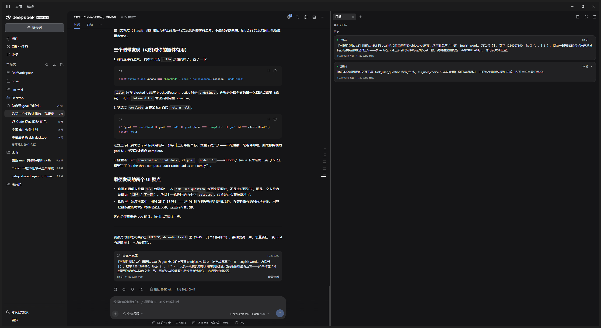

# dsh-goal-history · Goal History for DeepSeek Harness

English | [简体中文](https://github.com/Ryuu-64/dsh-goal-history/blob/main/docs/README.zh-CN.md)

npm: [@ryuu-64/dsh-goal-history](https://www.npmjs.com/package/@ryuu-64/dsh-goal-history) · Maintained by [Ryuu-64](https://github.com/Ryuu-64).

Keep a conversation's goals reviewable after they finish. DSH hides the goal bar when a goal completes, so the objective, its result, and its token usage scroll out of sight. This plugin leaves a record in the chat and adds a read-only history page beside it.

## See it in action

A completed goal keeps its objective, rounds started versus the round cap, completion time, and token usage under the turn that finished it. The same conversation's goals are listed in the right sidebar.



*The conversation and its Goals page, shown in Simplified Chinese.*

## What it adds

- **A completed-goal card under the turn that completed it.** The card shows the objective as recorded at completion, rounds started versus the round cap, the completion time, and the goal's token usage, with a link to the full history. It sits outside the collapsible tool group, like the built-in plan and schedule cards.
- **A Goals page in the right sidebar.** It lists the current goal and every past goal of the conversation, including cleared ones. Each row shows phase, objective, rounds started versus the round cap, timestamps, and token usage; expanding a row shows its goal changes and any blocker reason. The page also shows a token usage total across the conversation's goals.
- **A goal button in the session header.** It appears only when the conversation records at least one goal and opens the Goals page.
- **The full list comes from the Host, not from the loaded chat window.** The page can show goals from earlier in a long conversation without scrolling the transcript first.

The current goal's bar, and every edit, pause, resume, or clear action, stay with DSH itself. This plugin only reads and presents.

## Execution rounds

A goal records **rounds started** and a **round cap** (`maxGoalRounds`). A **Goal Round** is one automatic continuation: when the agent is idle, the goal is active and armed, and the cap has room, the goal round driver admits one goal-sourced message so the model gets another turn toward the objective. Only an admitted goal message advances the count; reaching the cap records a `round-limit` blocker.

The plugin shows this as **Rounds** (`执行轮次` in Chinese) `started / cap`. A completed goal may have used zero rounds when it finished in the original turn; the cap is an allowance, not a plan. The plugin does not show a separate round snapshot on every goal change; that was an implementation detail and read like a per-operation count.

## Token usage

`goal/change` records do not carry token counts. Token usage is recorded on each final assistant message, so the plugin sums the assistant usage that occurred while a goal was current: from the goal's `create` event to its `complete` or `clear` event. The total includes uncached input, output, cached input, and cache write, the same buckets as DSH's own usage footer. Hovering a token number shows the breakdown.

This is a review number, not a billing statement:

- Messages before the goal was created and messages after it completed or was cleared are not counted.
- A goal that stays active across several Goal Rounds accumulates usage from all of them.
- Messages without recorded usage are not counted.
- Several goals in one conversation are reported separately; the page total is their sum.

## Install

Ask an AI assistant that can operate your computer:

> Install this plugin in my DSH setup, check compatibility, and confirm it is enabled: https://github.com/Ryuu-64/dsh-goal-history

## Try it

1. In a DSH conversation, set a goal and let the assistant work on it until it completes, or ask it to create and complete a test goal.
2. Open the goal button in the session header. The Goals page lists the goal with its objective, rounds started versus the round cap, timestamps, and token usage.
3. Scroll to the completing turn. The completed-goal card shows the same record under the closing reply.
4. Refresh or reopen the conversation; both surfaces rebuild from the saved session.

## What stays visible

| Record | Chat card | Goals page |
| --- | --- | --- |
| Active, paused, or blocked goal | No; the goal bar shows it | Yes, under Current goal |
| Completed goal | Yes, under the completing turn | Yes, under Past goals |
| Cleared goal | No | Yes, under Past goals, with the last objective |
| Goal replaced by a new goal | Yes, for each completed goal | Yes, one row per goal |
| Goal changes and blocker reason | No | Yes, expand the row |
| Rounds started versus the round cap | Yes, on the completion card | Yes, on each row |
| Token usage | Yes, on the completion card | Yes, on each row and as a page total |

## Limits

- **One conversation at a time.** Goals are session-scoped in DSH; the page and the header button only describe the open conversation.
- **Completion records need a closing turn.** A goal completed by a tool call inside a turn gets a card. A goal completed outside a turn (for example by a command that starts no turn) is still listed in the Goals page, but has no chat card.
- **The chat card is a completion record.** It is not added at creation, and it is not added when a goal is cleared.
- **Token usage follows the goal's current span.** The closing reply after a completion event is outside that span; it is not counted. Treat the number as the goal's working cost, not an invoice.
- **The page is read-only.** Editing, pausing, resuming, and clearing remain on DSH's goal bar and `/goal` command.
- **Old records are shown as recorded.** Text is rendered as plain text, not Markdown, and missing fields are not invented.

## Compatibility

Built and verified against DeepSeek Harness `0.2.2-rc.3` (Desktop `2.0.23-next`) on Windows. The plugin uses the public `goal/change` event, one Host session projection, and three public client slots; it makes no model calls and sends no conversation data outside DSH. See [compatibility notes](https://github.com/Ryuu-64/dsh-goal-history/blob/main/docs/compatibility.md) for the exact attachment points, execution-round semantics, and token-accounting rules.

When updating an installed copy, restart DSH so the Host half reloads and a conversation refolds its goal history. A browser refresh reloads only the client half; a long-running Host can otherwise keep the goal state produced before the update.

## Feedback

Report problems in [GitHub Issues](https://github.com/Ryuu-64/dsh-goal-history/issues), including your DSH version, plugin version, and steps to reproduce. Leave out secrets and private conversations.

QQ group: **1129212995**.

## Development

```sh
npm test          # fold tests for goal/change and assistant usage events
npm run check     # syntax checks plus tests
```

The Host half registers one session projection (`goalHistory`) that folds durable `goal/change` and final `assistant/message` usage events. The browser half registers a `conversation.chat.turnTail` entry, a `conversation.session.header.utilities` entry, and a right-Sidebar page type. Both halves ship in this package.
