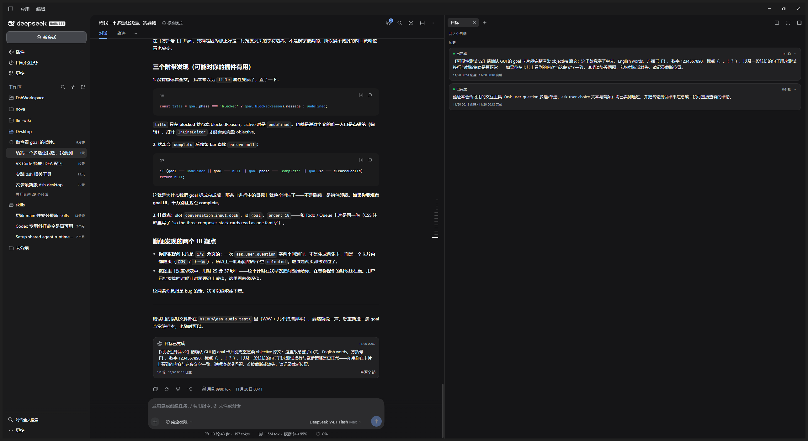

# dsh-goal-history · 目标历史

[English](../README.md) | 简体中文

npm：[`@ryuu-64/dsh-goal-history`](https://www.npmjs.com/package/@ryuu-64/dsh-goal-history) · 维护者：[Ryuu-64](https://github.com/Ryuu-64)

目标完成以后，DSH 会把输入框上方的目标条隐藏，目标正文、结果和消耗就滚出了视野。这个插件把目标记录留在聊天里，并在右侧栏加一个只读的历史页。

## 效果

目标完成的那一轮末尾会留一张卡：目标原文、轮次、完成时间、消耗的 token，以及“查看目标历史”。同一个对话的全部目标都在右侧栏的“目标”页里。



*截图使用简体中文界面。*

## 它增加了什么

- **聊天里的完成卡**：放在目标完成那一轮回答的末尾，工具折叠区之外。显示完成时的目标原文、轮次、完成时间和 token 消耗。
- **右侧栏的“目标”页**：列出当前目标和全部历史目标（包括已清除的）。每行显示状态、目标原文、轮次、时间和 token；展开可以看到变更记录和受阻原因。页面顶部还会显示这些目标的合计消耗。
- **会话标题栏的目标按钮**：只有这个对话有目标时才出现，点开就是“目标”页。
- 目标历史由 Host 端汇总，不依赖聊天滚到哪里；长对话里也能一次看到全部目标。

编辑、暂停、恢复、清除仍然由 DSH 自己的目标条负责，插件只读。

## token 消耗怎么算

`goal/change` 记录里没有 token 数。token 用量记在每条最终的助手消息里，所以插件把目标“当前”期间发生的助手用量加起来：从目标的 `create` 事件到 `complete` 或 `clear` 事件。总量包含输入、输出、缓存读、缓存写，和 DSH 自己的用量 footer 用同一组桶；悬停 token 数字可以看到拆分。

这是一个回看数字，不是账单：

- 目标创建之前、完成或清除之后的消息不计入。
- 目标跨多轮持续存在时，这段时间的用量都会累计。
- 没有记录用量的消息不计入。
- 一个对话里的多个目标分别统计，页面顶部是它们的合计。

## 安装

把下面这句话交给能操作电脑的 AI 助手：

> 在我的 DSH 里安装这个插件，检查兼容性并确认它已启用：https://github.com/Ryuu-64/dsh-goal-history

## 试用

1. 在 DSH 对话里设置一个目标，让助手一直做到完成；或者让助手创建并完成一个测试目标。
2. 点会话标题栏的目标按钮。“目标”页会列出这个目标的原文、轮次、时间和 token。
3. 滚到完成那一轮，完成卡里是同一份记录。
4. 刷新或重新打开对话，两个界面都会从保存的会话里重建。

## 哪些内容会保留

| 记录 | 聊天卡 | 目标页 |
| --- | --- | --- |
| 进行中 / 已暂停 / 受阻的目标 | 不显示；目标条上有 | 显示在“当前” |
| 已完成的目标 | 显示在完成那一轮 | 显示在“历史” |
| 已清除的目标 | 不显示 | 显示在“历史”，保留最后一次目标原文 |
| 被新目标替换的旧目标 | 每个已完成目标各一张卡 | 每个目标一行 |
| 变更记录和受阻原因 | 不显示 | 展开行查看 |
| token 消耗 | 完成卡上 | 每行以及页面合计 |

## 已知边界

- **一次只看一个对话。** goal 是会话级的，页面和标题栏按钮只描述当前打开的对话。
- **完成记录需要一个收尾回合。** 在回合内因工具调用而完成的目标有聊天卡；在回合之外完成的目标仍然会出现在“目标”页，但没有聊天卡。
- **聊天卡只记录“完成”。** 创建时不加卡，清除时也不加卡。
- **token 按目标的“当前期间”统计。** 完成事件之后的收尾回复不在这个区间里，不计入；把它当作目标的工作成本，而不是账单。
- **页面只读。** 编辑、暂停、恢复、清除仍然在 DSH 目标条和 `/goal` 命令上。
- **旧记录按原样展示。** 文本按纯文本渲染，不执行 Markdown；缺失的字段不会被补造。

## 兼容性

针对 DeepSeek Harness `0.2.2-rc.3`（Desktop `2.0.23-next`）在 Windows 上构建和验证。插件使用公开的 `goal/change` 事件、一个 Host 端会话级只读数据单元和三个公开客户端挂载点；不调用模型，不把对话数据发到 DSH 之外。具体接入点和 token 规则见[兼容说明](compatibility.md)。

更新已安装的插件后请**重启 DSH**，让 Host 半重新加载并让会话重新折叠目标历史。只刷新浏览器只会重载浏览器半；长时间运行的 Host 可能保留更新前的目标状态（目标有，token 没有）。

## 反馈

有问题请到 [GitHub Issues](https://github.com/Ryuu-64/dsh-goal-history/issues) 反馈，附上 DSH 版本、插件版本和复现步骤；不要贴密钥或私人对话。

QQ 群：**1129212995**。

## 开发

```sh
npm test          # goal/change 与助手用量事件的折叠测试
npm run check     # 语法检查加测试
```

Host 端注册一个会话级只读数据单元（`goalHistory`），把 `goal/change` 和最终的 `assistant/message` 用量折进去；浏览器端注册 `conversation.chat.turnTail`、`conversation.session.header.utilities` 和右侧栏页面类型。两半都在这个包里。
